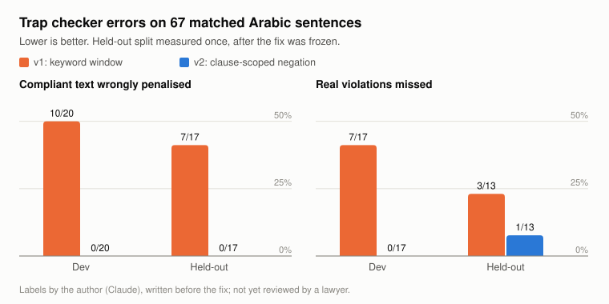

# Arabic Legal Reward Reliability

### Better evidence and better rewards for AI in MENA legal and financial workflows

**A model can produce a convincing answer and still be wrong. An evaluator can also penalize an answer that is right.** This project investigates both sides of that problem through Arabic legal drafting: how to build tasks, evidence, and scoring rules that deserve to be used for evaluation—and eventually for training.

**Mohamed Zaghoo** · Applied physics → AI post-training → MENA financial infrastructure

[Benchmark results](#benchmark-results) · [Why this matters](#why-high-quality-data-matters-in-mena) · [Run the demo](#run-the-public-demo) · [Technical methods](docs/METHODS.md)

| Original exploratory study | Public, runnable release | Current research stage |
|---|---|---|
| 6 Arabic legal tasks · 109 weighted criteria | 1 synthetic task · 67 frozen matched sentences | Trap checks validated on held-out sentences; no RL training |

## Why high-quality data matters in MENA

An Arabic contract or financial instruction carries more than language. Its meaning depends on the jurisdiction, relevant date, source documents, parties, and the action being requested. MENA is not a single legal system, and this Saudi-focused study does not establish coverage across the region or its languages.

The research thesis is straightforward: **useful domain data must tell a model what to do, give it the evidence needed to do it, and let an evaluator distinguish success from a plausible mistake.** More examples alone cannot resolve an unstated requirement or an unreliable answer key.

| What quality requires | In legal tasks | In proposed finance tasks |
|---|---|---|
| Explicit context | Jurisdiction, applicable date, contract terms | Currency, accounting period, transaction state |
| Traceable evidence | Source document and relevant provision | Invoice, ledger entry and settlement record |
| Precise success conditions | Preserve rights and obey drafting constraints | Reconcile balances and avoid duplicate financial effects |
| Meaning-sensitive grading | Distinguish a prohibition from its negation | Distinguish a requested refund from a completed refund |
| Independent validation | Qualified review of legal reasoning | Reconciled records and reviewed financial invariants |

The legal column motivates the present pilot; the finance column is a proposed extension, not a completed benchmark. In both, a training reward is only as useful as the evidence and verifier behind it. Whether better task data improves trained-model behavior remains a question for a future controlled experiment.

Arabic evaluation already has substantive foundations: [ArabicMMLU](https://aclanthology.org/2024.findings-acl.334/) draws on regional educational material, while [ArabLegalEval](https://aclanthology.org/2024.arabicnlp-1.20/) evaluates Arabic legal knowledge. This smaller project examines a specific issue within that broader effort: **the reliability of rewards for open-ended professional drafting.**

## Benchmark results

**Historical raw reward × 100—not accuracy, pass rate, or a model ranking.** These scores include known evaluator defects. There is one saved answer per model per task; the generation harnesses differ, and rubrics were revised after inspecting outputs.

| Task | GPT-6 Astra | Claude Opus 5.5 | Interpretation |
|---|---:|---:|---|
| Consulting contract review | 72.50 | 75.00 | Development-set rubric |
| Maintenance contract review | 77.38 | 85.71 | Development-set rubric |
| Partner exit preparation | 73.00 | 83.33 | Semantic structure checks miss paraphrases |
| Payment demand letter | 45.96 | 84.85 | Astra negation falsely triggers a penalty |
| Probation termination memo | 43.94 | 37.88 | Astra contractual example falsely triggers a penalty |
| Mutual NDA drafting | 29.47 | 76.36 | False IP-transfer penalty; jurisdiction missing from prompt |

Astra used Codex at high reasoning; Claude used the project's provider adapter. Full scores combine deterministic checks with a Claude Opus 5.5 judge. Names denote requested experiment settings, not independent confirmation of backend model identity. Judge dependence, incomplete references, and unverified source claims further limit comparisons.

The numbers are retained as observations about an experimental evaluator. No aggregate winner is reported. [Machine-readable summary](docs/benchmark_summary.json) · [Research note](docs/RESEARCH_NOTE.md)

## Main result: measured and reduced trap errors

On 67 matched Arabic sentences, frozen before any change and split into dev and held-out halves, the original trap checker wrongly penalised **46% of compliant sentences** and missed **33% of violations**. Making negation clause-scoped brought the held-out split to **0/17 false penalties and 1/13 misses**. The held-out half was scored once, after the fix was frozen.



On the private six-task corpus, the fix changed exactly three gate decisions, all known false positives. It let no reference, negative control or real violation through:

| GPT-6 Astra answer | Raw reward, historical checker | After the fix |
|---|---:|---:|
| Payment demand letter | 0.46 | 0.72 |
| Probation termination memo | 0.44 | 1.00 |
| Mutual NDA drafting | 0.29 | 0.66 |

The probation comparison reverses. Astra's memo is correct on the 1446H amendment (Royal Decree M/44), while Claude Opus 5.5's memo still triggers the trap (0.38) because it states the repealed 90-day rule as current law. The old checker had turned a correct answer into an apparent model failure.

The labels were written by an AI assistant, not independent legal reviewers, and the sample is small: 0/17 has a 95% upper bound of about 16%. [Method, per-phenomenon errors and limitations](experiments/verifier_validation/README.md).

## Why it mattered: scoring errors can look like model failures

Three cases illustrate why data and verifier quality belong in the same research program:

1. **Negation changes the meaning, but not always the score.** A statement rejecting IP transfer triggered the NDA rule intended to prohibit IP transfer. The failed gate multiplied the entire answer score by 0.5.
2. **Context changes the rule being discussed.** The probation checker treated discussion of a contractual 90-day period as a claim about the statutory maximum, despite the response also stating a 180-day ceiling.
3. **The rubric can ask for information the prompt never supplied.** The NDA grader expected Saudi-specific grounding, but jurisdiction metadata was not included in the generation prompt. That calls for a new prompt version and new model runs.

The public demo reproduces the first mechanism with newly written text: a reminder saying it **does not** demand compensation receives the same score as one saying it does. It is deliberately small enough to inspect end to end. The demo rubric keeps the naive trap so the defect stays visible; a test shows that the same trap with `clause_negation` passes the negated reminder and still penalises the asserted one. Mechanisms 1 and 2 are addressed by the validation above. Mechanism 3 needs a new prompt version and is still open.

## How the evaluator works

```text
Task + candidate answer
        ↓
Arabic normalization → deterministic checks
        + optional rubric-based LLM judge
        ↓
Per-criterion scores and evidence
        ↓
Weighted score × failed-gate multipliers
```

`reward = (sum(weight × item_score) / sum(scored_weights)) × product(failed_gate_multipliers)`

Rules cover patterns, structure, citation ranges and known error signatures. The optional judge handles qualitative rubric items. A gate failure both loses criterion credit and reduces the whole answer's reward, amplifying false positives. Rules-only mode excludes judge criteria from the denominator.

This is a **hybrid evaluation and reward prototype**. An LLM judgment is not an objectively verifiable reward; a regex match is not a proof of legal correctness. The code supplies a single-step reward interface, but no model weights have been trained or updated.

## Run the public demo

Python 3.10+; no API key or external dependency needed:

```bash
python3 -m unittest discover tests
python3 -m experiments.verifier_validation.measure
python3 -m legal_rlvr.evaluate
python3 tools/check_release.py
```

The synthetic example earns **0.375**: a 0.75 base score multiplied by a 0.5 gate. Eight tests cover the demo (including reproduction of the known defect and its fix) and reproduce the verifier-validation numbers. Passing them does not establish semantic correctness. Evaluation writes and replaces `results/report.md` and `results/scores.json`.

```python
from legal_rlvr import LegalDraftingEnv

env = LegalDraftingEnv("synthetic_notice", use_judge=False)
prompt = env.reset()
reward, evidence = env.step("Your candidate answer")
```

The original six task packages, source-derived references, raw model outputs, and session logs are withheld. This checkout reproduces the synthetic failure demonstration, **not the historical six-task scores**. See [release scope](docs/RELEASE_SCOPE.md).

## Next experiments

- **Finish validating the verifier:** the trap checks now have a frozen matched-pair test (above). Next: have a qualified Saudi lawyer review its labels and write a new held-out set from a different author, then extend the same test to positive criteria, which still miss Arabic paraphrases.
- **Fix the hidden NDA requirement:** version the prompt with explicit jurisdiction and regenerate, rather than re-scoring old answers against a requirement they were never given.
- **Separate development from evaluation:** freeze prompts and rubrics before testing held-out task variants; record changes and keep historical results intact.
- **Improve model comparisons:** match prompts and tool access, collect multiple samples, and report uncertainty alongside independent human assessment.
- **Extend to financial workflows:** build synthetic reconciliation and refund tasks whose outcomes can be checked against ledgers and state transitions. Test adversarial shortcuts before using their rewards for optimization.

The aim is to develop **domain evaluation data with explicit assumptions, auditable evidence, and measured verifier reliability**. Those are prerequisites for investigating whether the same tasks can provide useful training signals.

[Technical methods and limitations](docs/METHODS.md) · [Historical research note](docs/RESEARCH_NOTE.md) · [Release scope](docs/RELEASE_SCOPE.md)

Development used AI assistance for code, examples, documentation and analysis. No employer or model-provider endorsement is implied.

No open-source license has been selected; public visibility alone does not grant reuse rights.
