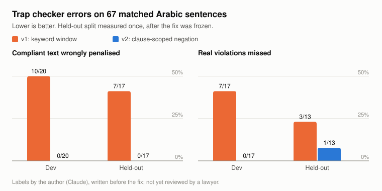

# Verifier validation: do the trap checks punish correct answers?

Trap checks are the most consequential part of the reward. A failed trap is a gate: it removes the criterion's credit *and* multiplies the whole answer's reward by 0.5–0.7. The historical study found three cases where a trap fired on a statement that *rejected* the prohibited action. This experiment measures how often that happens, and whether a principled fix generalises to examples it wasn't tuned on.



## Result

| Split | Checker | Compliant text wrongly penalised | Violations missed | Accuracy |
|---|---|---|---|---|
| Dev | v1 (keyword window) | 10/20 (50%) | 7/17 (41%) | 0.54 |
| Dev | v2 (clause-scoped negation) | 0/20 | 0/17 | 1.00 *(tuned on these)* |
| **Held-out** | v1 | 7/17 (41%) | 3/13 (23%) | 0.67 |
| **Held-out** | **v2** | **0/17** | **1/13 (8%)** | **0.97** |

The original checker penalised 46% of all compliant sentences and missed 33% of violations. The held-out split was scored once, after the fix was frozen. Its one remaining miss («نوجه إليكم هذا الإعذار الرسمي», with the article on the adjective) was deliberately left unfixed.

## Method

1. **Matched sentences, written before any fix.** `pairs.json` holds 67 short Arabic sentences for six traps. Each is labelled `violation` or `compliant` and tagged with a phenomenon:
   - **Correct text that uses the trap's words:** negation («ولا تُقدَّم بوصفها إنذارًا نظاميًا»), lexical negation («خالية من», «نمتنع عن»), superseded framing («لم يعد ساريًا»), contractual vs statutory framing («إذا نص العقد على تجربة 90 يومًا»), and a quoted instruction or question.
   - **Near-miss violations:** a negation in a *different* clause («ليس لدينا رغبة في النزاع، وهذه إنذار نظامي»), a prohibition worded with a negation («لا يجوز … منافسة الطرف المفصح»), an excuse word used in a different sense («الضريبة 5% كما كانت دائمًا»), and paraphrases.

   The six traps are: no added interest or fees, not calling a letter a formal notice, no outdated 90-day probation rule, no non-compete or IP transfer in an NDA, no Board of Grievances for commercial disputes, and no 5% VAT.

   The near-misses are what stop "accept anything containing a negation word" from looking like a fix.
2. **Frozen and split.** The SHA-256 of the set was recorded before the checker changed (`FROZEN_SHA256` in `measure.py`, verified on every run). It was split by trap × label with seed 20261116 into 37 dev and 30 held-out items.
3. **Fix, designed on dev errors only.** `clause_negation` in `legal_rlvr/checks.py` excuses a trap hit only when a negator governs it inside its own clause:
   - before the hit («ولا تقدم بوصفها …»), or right after it («5% لم تعد سارية»);
   - clauses break at punctuation and at «لكن / غير أن / بل / أما»;
   - deontic and affirmative «لا» (لا يجوز، لا يحق، لا شك، لا بد) is not treated as negation.

   `sentence_unless` excuses a contractual-term cue within the same sentence. In the trap definitions, negation words were moved out of the old nearby-word excuse lists, bare «كان/كانت» was dropped as a "this was the old law" cue, and dev paraphrases were added. Before and after definitions are both in `trap_specs.json`.
4. **Held-out scored once.**

## Effect on the historical benchmark (private corpus)

Re-scoring every saved answer in the private six-task corpus (judge from cache) changed three rewards. All three are the false positives described in the research note:

| Candidate | Text the old trap penalised | Raw reward v1 → v2 |
|---|---|---|
| GPT-6 Astra, payment letter | «ولا تُقدَّم بوصفها إنذارًا نظاميًا مكتملًا» | 0.46 → **0.72** |
| GPT-6 Astra, probation memo | «إذا نص العقد على تجربة مدتها 90 يومًا…» (a contractual example) | 0.44 → **1.00** |
| GPT-6 Astra, NDA | «ولا تتضمن أي التزام بعدم المنافسة», «ولا تنقل هذه الاتفاقية أي ملكية فكرية» | 0.29 → **0.66** |

Nothing else changed:
- No reference or negative-control decision changed.
- Claude Opus 5.5's probation memo is still penalised, because it states the repealed 90-day rule as current law.

With the corrected checker, the probation comparison reverses: Astra 1.00, Claude 0.38. The old checker had turned a correct answer into an apparent model failure. This row can't be reproduced from this repository, because the task corpus is withheld.

## Limitations

- **The labels are not independent.** The sentences and labels were written by an AI assistant (Claude), including the held-out half. The split guards against tuning, not against one author's blind spots. The next step is review by a qualified Saudi lawyer, plus a new held-out set from a different author.
- **The sample is small.** 0/17 has a one-sided 95% upper bound of about 16%.
- **Only trap criteria were tested.** Positive criteria also miss paraphrases (for example, Astra's NDA lost credit on burden-of-proof and bracket items) and need the same treatment.
- **Clause scoping is still a heuristic**, not semantic parsing.
- **The NDA prompt still omits jurisdiction**, which the rubric rewards. Fixing that needs a new prompt version and new generations.

## Reproduce

```bash
python3 -m experiments.verifier_validation.measure    # prints the table, writes measured.json
python3 -m unittest discover tests                    # includes a check of these numbers
```
